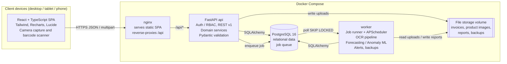
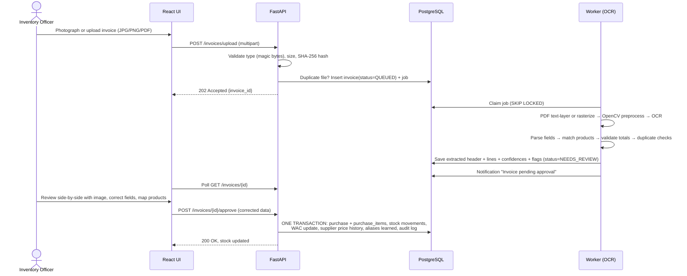
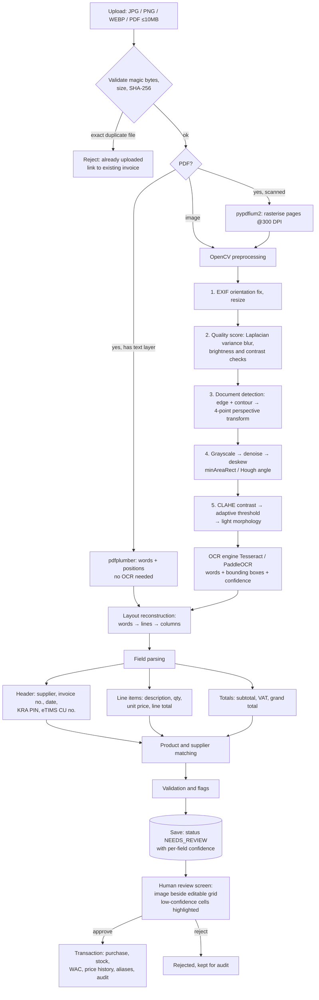

# System Design Plan: AI-Driven Smart Inventory Management and Automated Receipt Digitization System

> Status: **Planning. Awaiting approval before Phase 1.**
> Currency: Kenyan Shillings (KES) · Timezone: Africa/Nairobi · VAT default: 16% (configurable)

This document covers the eight items requested before coding starts:

1. [Recommended system architecture](#1-recommended-system-architecture)
2. [Project folder structure](#2-project-folder-structure)
3. [Database ERD and table relationships](#3-database-erd-and-table-relationships)
4. [Technology justification](#4-technology-justification)
5. [AI and OCR implementation strategy](#5-ai-and-ocr-implementation-strategy)
6. [Development timeline](#6-development-timeline)
7. [Estimated development complexity](#7-estimated-development-complexity)
8. [Installation prerequisites](#8-installation-prerequisites)
9. [Decisions needing your approval](#9-decisions-needing-your-approval)

---

## 1. Recommended System Architecture

### 1.1 Style

The system is a **modular monolith**: one FastAPI codebase split into clear domain modules, deployed as two processes.

| Process | Responsibility |
|---|---|
| **api** | Serves the REST API. Handles auth, CRUD and transactional writes (sales, purchases, stock). Requests stay short; anything slow is handed to the worker. |
| **worker** | Runs the same codebase in worker mode. Does the slow and CPU-bound work: OCR jobs, nightly forecasting, anomaly scans, alert generation, scheduled backups. |

Microservices would add network hops, duplicated auth and more containers, with no benefit for a single supermarket on a laptop. Keeping the domain modules cleanly separated still lets one be split out later if needed.

**No Redis or Celery.** The job queue lives in a PostgreSQL table (`background_jobs`), read with `SELECT … FOR UPDATE SKIP LOCKED`, and APScheduler triggers the periodic jobs. That removes a whole container and roughly 100–150 MB of RAM, and the queue is enough for the workload here (a few OCR jobs a minute at most).

### 1.2 Architecture diagram



### 1.3 Backend layers

```
HTTP request
  → api/v1/<router>.py          routing, auth dependency, permission check, Pydantic I/O
  → services/<domain>_service   business rules, DB transaction boundaries, audit logging
  → models/ (SQLAlchemy ORM)    persistence
  → ai/ (OCR, forecasting, anomaly)  pure-Python engines; no HTTP knowledge, unit-testable
```

Rules applied throughout:

- **Routers contain no business logic.** They validate input, check permissions and call a service.
- **Every stock change goes through one function**, `InventoryService.apply_movement()`. It locks the product row (`SELECT … FOR UPDATE`), writes a `stock_movements` ledger row, updates the cached `quantity_on_hand`, recalculates weighted average cost on receipts, and refuses to go negative unless an authorised override is supplied. Sales, purchases, returns, adjustments and write-offs all call it.
- **Critical operations run in one database transaction**: sale checkout, invoice approval, goods receipt, return/refund and stock adjustment. Either everything commits or nothing does.
- **Money uses `NUMERIC(14,2)` and Python `Decimal`**, never float. Quantities use `NUMERIC(12,3)` so loose goods sold by weight (e.g. 1.250 kg of sugar) work.

### 1.4 Main data flows

**Invoice digitization (the core AI flow)**



**Sale (POS)**: scan barcode → cart → checkout → one transaction (sale, sale_items with a cost snapshot at the current WAC, FEFO batch deduction, stock movements, audit) → printable receipt (PDF/thermal-width HTML).

**Analytics**: dashboard KPIs are computed live with SQL aggregates over a date range. The worker writes forecasts and anomaly alerts nightly (and on demand) to `forecasts` / `anomaly_alerts`, and the dashboard reads those tables.

### 1.5 Security architecture (summary)

| Concern | Approach |
|---|---|
| Passwords | Argon2id hashing (`argon2-cffi`). Minimum length plus a common-password check. |
| Sessions | Short-lived JWT access token (15 min) held in memory. Rotating refresh token in an `HttpOnly; Secure; SameSite=Strict` cookie, stored **hashed** in `user_sessions` so it can be revoked ("log out all devices", admin force-logout). |
| Brute force | Per-IP and per-account rate limits on login; lockout after 5 failures for 15 min. |
| Authorization | Permission-based RBAC (`products:write`, `invoices:approve`, `stock:adjust_negative`, …). Roles are bundles of permissions. Checked on every endpoint by a FastAPI dependency and mirrored in the UI to hide controls (the UI check is cosmetic; the server always decides). |
| Input | Pydantic schemas with strict types and bounds. SQLAlchemy parameterised queries only, no string-built SQL. |
| Uploads | Allow-list by **magic bytes** (JPEG, PNG, WEBP, PDF), not by extension. 10 MB cap. Image re-encoded through Pillow to strip payloads and EXIF. Random UUID filenames outside the web root. Served only through an authenticated endpoint. PDF page limit. |
| Secrets | `.env` file (git-ignored) holding DB password, JWT secret, etc. `.env.example` is committed. The frontend never receives secrets. |
| Audit | `audit_logs`: who, what, when, IP and before/after JSON for every write on sensitive entities, plus logins and failed logins. Append-only at the application level. |
| Backup | Nightly `pg_dump` (custom format) plus a tarball of the uploads volume, rotated (7 daily, 4 weekly). Documented and tested restore script. |
| Transport | nginx with TLS in deployment (self-signed for the demo; Let's Encrypt or a store certificate in production). Security headers (CSP, X-Frame-Options, etc.). |

### 1.6 Role-based access matrix

| Capability | Super Admin | Store Manager | Inventory Officer | Cashier |
|---|:-:|:-:|:-:|:-:|
| Manage users and roles | ✅ | 👁 view | ❌ | ❌ |
| Products and categories: create/edit | ✅ | ✅ | ✅ | ❌ |
| Products: deactivate/delete | ✅ | ✅ | ❌ | ❌ |
| Product lookup / barcode search | ✅ | ✅ | ✅ | ✅ |
| Suppliers and purchase orders | ✅ | ✅ | ✅ | ❌ |
| Upload invoices / receipts | ✅ | ✅ | ✅ | ❌ |
| Approve digitized invoices | ✅ | ✅ | ✅ (configurable) | ❌ |
| Record sales (POS) | ✅ | ✅ | ❌ | ✅ |
| Returns and refunds | ✅ | ✅ | ❌ | request only (manager PIN to approve) |
| Damage / expiry write-offs | ✅ | ✅ | ✅ | ❌ |
| Manual adjustment (positive) | ✅ | ✅ | ✅ | ❌ |
| Adjustment that makes stock negative | ✅ | ❌ | ❌ | ❌ |
| Financial analytics and profit | ✅ | ✅ | ❌ | ❌ |
| Forecasts | ✅ | ✅ | ✅ | ❌ |
| Anomaly alerts | ✅ | ✅ | ❌ | ❌ |
| Reports export | ✅ | ✅ | inventory reports only | own daily sales only |
| Expenses | ✅ | ✅ | ❌ | ❌ |
| Audit logs, backups, settings | ✅ | ❌ | ❌ | ❌ |

---

## 2. Project Folder Structure

```
ai-powered-system/
├── README.md
├── .env.example                      # template for all config; real .env is git-ignored
├── .gitignore
├── docker-compose.yml                # db, api, worker, web (production-like)
├── docker-compose.dev.yml            # hot reload, exposed ports, mounted source
├── Makefile                          # make up / seed / test / backup / restore shortcuts
│
├── backend/
│   ├── Dockerfile                    # python:3.12-slim + tesseract-ocr; non-root user
│   ├── pyproject.toml                # deps and tooling (ruff, pytest, mypy)
│   ├── alembic.ini
│   ├── alembic/
│   │   ├── env.py
│   │   └── versions/                 # one migration per phase
│   ├── app/
│   │   ├── main.py                   # FastAPI factory, middleware, routers, health check
│   │   ├── core/
│   │   │   ├── config.py             # pydantic-settings, reads env vars
│   │   │   ├── database.py           # engine, session factory, transaction helper
│   │   │   ├── security.py           # Argon2, JWT, refresh-token rotation
│   │   │   ├── permissions.py        # permission constants and role → permission seeds
│   │   │   ├── rate_limit.py
│   │   │   ├── exceptions.py         # domain errors → consistent JSON error envelope
│   │   │   └── logging.py
│   │   ├── models/                   # SQLAlchemy 2.0 ORM (typed Mapped[] columns)
│   │   │   ├── base.py               # Base, timestamp mixin, soft-delete mixin
│   │   │   ├── auth.py               # User, Role, Permission, RolePermission, UserSession, PasswordResetToken
│   │   │   ├── catalog.py            # Category, Product, ProductBatch
│   │   │   ├── supplier.py           # Supplier, SupplierProduct, SupplierProductAlias, SupplierPriceHistory
│   │   │   ├── procurement.py        # PurchaseOrder(+Items), Purchase(+Items)
│   │   │   ├── invoice.py            # Invoice, InvoiceItem
│   │   │   ├── sales.py              # Customer, Sale, SaleItem, SaleReturn(+Items)
│   │   │   ├── stock.py              # StockMovement, StockAdjustment
│   │   │   ├── finance.py            # Expense, ExpenseCategory
│   │   │   ├── ai.py                 # ForecastRun, Forecast, AnomalyAlert
│   │   │   └── system.py             # Notification, AuditLog, BackgroundJob, Setting
│   │   ├── schemas/                  # Pydantic request/response models, mirroring models/
│   │   ├── api/
│   │   │   ├── deps.py               # get_db, get_current_user, require_permission(...)
│   │   │   └── v1/
│   │   │       ├── router.py
│   │   │       ├── auth.py  users.py  roles.py
│   │   │       ├── categories.py  products.py  barcodes.py
│   │   │       ├── suppliers.py  purchase_orders.py  purchases.py
│   │   │       ├── invoices.py       # upload, status, review, approve, reject, file download
│   │   │       ├── sales.py  returns.py  customers.py
│   │   │       ├── stock.py          # movements ledger, adjustments, write-offs, batches
│   │   │       ├── expenses.py
│   │   │       ├── dashboard.py  analytics.py
│   │   │       ├── forecasts.py  anomalies.py
│   │   │       ├── notifications.py  reports.py  audit.py  settings.py
│   │   ├── services/                 # business logic and transaction boundaries
│   │   │   ├── auth_service.py
│   │   │   ├── inventory_service.py  # apply_movement(), WAC, FEFO, negative-stock guard
│   │   │   ├── product_service.py
│   │   │   ├── supplier_service.py
│   │   │   ├── procurement_service.py
│   │   │   ├── invoice_service.py    # approval → purchase + stock in one transaction
│   │   │   ├── sales_service.py      # checkout, discounts, VAT, receipt numbering
│   │   │   ├── returns_service.py
│   │   │   ├── analytics_service.py  # revenue, COGS, gross profit and margin
│   │   │   ├── notification_service.py
│   │   │   ├── audit_service.py
│   │   │   └── report_service.py
│   │   ├── ai/
│   │   │   ├── ocr/
│   │   │   │   ├── preprocessing.py  # OpenCV: perspective, deskew, denoise, threshold, blur score
│   │   │   │   ├── pdf.py            # text-layer extraction, rasterisation
│   │   │   │   ├── engines/
│   │   │   │   │   ├── base.py       # OCREngine protocol → words with bboxes and confidence
│   │   │   │   │   ├── tesseract_engine.py
│   │   │   │   │   └── paddle_engine.py   # optional, behind a feature flag
│   │   │   │   ├── layout.py         # words → lines → column/table reconstruction
│   │   │   │   ├── patterns.py       # regexes: dates, KES amounts, invoice no., KRA PIN, VAT
│   │   │   │   ├── parser.py         # header fields and line items, per-field confidence
│   │   │   │   ├── matcher.py        # product and supplier matching (exact, alias, fuzzy)
│   │   │   │   ├── validator.py      # arithmetic checks, duplicates, price-change flags
│   │   │   │   └── pipeline.py       # orchestrates the stages → ExtractionResult
│   │   │   ├── forecasting/
│   │   │   │   ├── data.py           # daily demand series (zero-filled), holidays
│   │   │   │   ├── features.py       # lags, rolling stats, calendar, payday flags
│   │   │   │   ├── models.py         # Naive, SeasonalNaive, MovingAvg, Holt-Winters, Croston/SBA, GBR
│   │   │   │   ├── backtest.py       # rolling-origin evaluation
│   │   │   │   ├── selector.py       # best model per product by validation MASE
│   │   │   │   ├── classification.py # fast/slow movers, ABC, intermittency
│   │   │   │   └── replenishment.py  # stock-out date, reorder point, reorder qty
│   │   │   ├── anomaly/
│   │   │   │   ├── features.py       # product-day and user-day feature matrices
│   │   │   │   ├── rules.py          # transparent threshold rules
│   │   │   │   ├── isolation_forest.py
│   │   │   │   └── scorer.py         # merge rule and model signals → severity and explanation
│   │   │   └── evaluation/
│   │   │       ├── ocr_metrics.py  forecast_metrics.py  anomaly_metrics.py
│   │   ├── workers/
│   │   │   ├── runner.py             # job loop (SKIP LOCKED), retries, timeouts
│   │   │   ├── handlers.py           # job type → function
│   │   │   └── scheduler.py          # nightly forecast and anomaly runs, alerts, backups
│   │   ├── reports/                  # ReportLab PDF, openpyxl Excel, CSV writers
│   │   └── utils/                    # money.py, files.py (safe upload), barcode.py, dates.py
│   ├── scripts/
│   │   ├── create_superadmin.py
│   │   ├── seed_demo_data.py         # labelled SYNTHETIC store: products, 12 months of sales
│   │   ├── generate_synthetic_invoices.py  # renders invoice images + ground-truth JSON
│   │   ├── evaluate_ocr.py  evaluate_forecasts.py  evaluate_anomalies.py
│   │   └── backup.sh  restore.sh
│   └── tests/
│       ├── conftest.py               # throwaway Postgres DB per session, factories, auth helpers
│       ├── unit/                     # WAC, VAT, discounts, parser, matcher, metrics, models
│       ├── integration/              # API tests through httpx against a real Postgres
│       ├── ocr/                      # pipeline tests on fixture images vs ground truth
│       ├── e2e_scenarios/            # the 9-step demo scenario as an automated test
│       └── fixtures/invoices/        # images/PDFs + *.truth.json
│
├── frontend/
│   ├── Dockerfile                    # node build stage → nginx:alpine
│   ├── nginx.conf                    # SPA fallback, /api proxy, security headers
│   ├── package.json  vite.config.ts  tsconfig.json  tailwind.config.ts  postcss.config.js
│   ├── index.html
│   └── src/
│       ├── main.tsx  App.tsx  routes.tsx
│       ├── api/
│       │   ├── client.ts             # axios instance, silent token refresh, error normalisation
│       │   └── *.ts                  # typed endpoint functions per domain
│       ├── auth/                     # AuthProvider, ProtectedRoute, usePermission, Can component
│       ├── components/
│       │   ├── layout/               # AppShell, Sidebar, Topbar, NotificationBell
│       │   ├── ui/                   # Button, Input, Select, Modal, ConfirmDialog, DataTable,
│       │   │                         # Pagination, Badge, Toast, Card, StatCard, EmptyState, Spinner
│       │   └── charts/               # Recharts wrappers (actual vs forecast, trend, bar, donut)
│       ├── features/
│       │   ├── dashboard/  products/  categories/  suppliers/  procurement/
│       │   ├── receipts/             # Upload, CameraCapture, ReviewPage (image + editable grid)
│       │   ├── pos/                  # POS screen, Cart, BarcodeScanner, ReceiptPrint
│       │   ├── sales/  returns/  stock/  expenses/  finance/
│       │   ├── forecasting/  anomalies/  notifications/  reports/
│       │   └── admin/                # users, roles, audit log, settings, backups
│       ├── hooks/                    # useDebounce, usePagination, useBarcodeScanner
│       ├── lib/                      # formatKES, dates, validation schemas (zod)
│       ├── types/
│       └── test/                     # Vitest setup, MSW handlers
│
├── sample-data/                      # clearly labelled SYNTHETIC demo data
│   ├── invoices/                     # generated supplier invoices (PNG/PDF) + truth JSON
│   └── README.md                     # how the data was generated; not real business data
│
└── docs/
    ├── 00-system-design-plan.md      # this document
    ├── architecture/                 # architecture, use-case, DFD (L0/L1), ERD diagrams
    ├── database-schema.md
    ├── api.md                        # plus live OpenAPI at /api/docs
    ├── ai/                           # OCR workflow, ML methodology, evaluation results
    ├── testing.md
    ├── installation.md
    └── user-manual.md                # per-role task guides with screenshots
```

**Who owns what**

| Component | Responsibility |
|---|---|
| `core/` | Configuration, DB sessions, security primitives. Holds no domain knowledge. |
| `models/` | Table definitions and relationships, the single source of truth for the schema (Alembic autogenerates from it, then each migration is reviewed by hand). |
| `schemas/` | API contract. Keeps internal columns (password hashes, costs for cashiers) from leaking. |
| `api/` | HTTP surface plus authorisation. Thin. |
| `services/` | Business rules and transactions. Unit and integration tests concentrate here. |
| `ai/` | Framework-independent engines (`numpy`/`pandas` in, dataclasses out). Testable without a database. |
| `workers/` | Moves slow work off the request path and runs schedules. |
| `frontend/features/` | One folder per screen group, each with its own components, hooks and API calls. |

---

## 3. Database ERD and Table Relationships

### 3.1 Conventions

- Primary keys: `BIGINT GENERATED ALWAYS AS IDENTITY`. Public-facing documents (sales, invoices) also get a human number (`RCPT-2026-000123`).
- Every table has `created_at` / `updated_at` (`timestamptz`, default `now()`). Master data uses soft delete via `is_active`, so history keeps referential integrity: a product with sales history is deactivated, not deleted.
- Money is `NUMERIC(14,2)`, quantity `NUMERIC(12,3)`, percentages `NUMERIC(5,2)`.
- Status columns are PostgreSQL `CHECK` constraints over a fixed list (simpler to migrate than native ENUM types).
- Foreign keys are `ON DELETE RESTRICT` by default. `CASCADE` applies only to pure child rows (e.g. `sale_items` of a draft sale).

### 3.2 ERD

```mermaid
erDiagram
    roles ||--o{ users : "has"
    roles ||--o{ role_permissions : ""
    permissions ||--o{ role_permissions : ""
    users ||--o{ user_sessions : "logs in"
    users ||--o{ password_reset_tokens : ""
    users ||--o{ audit_logs : "performs"
    users ||--o{ notifications : "receives"

    categories ||--o{ categories : "parent of"
    categories ||--o{ products : "groups"
    suppliers ||--o{ products : "default supplier"
    products ||--o{ product_batches : "stocked as"

    suppliers ||--o{ supplier_products : "offers"
    products ||--o{ supplier_products : ""
    suppliers ||--o{ supplier_product_aliases : "names products as"
    products ||--o{ supplier_product_aliases : ""
    products ||--o{ supplier_price_history : ""
    suppliers ||--o{ supplier_price_history : ""

    suppliers ||--o{ purchase_orders : "receives"
    purchase_orders ||--o{ purchase_order_items : "contains"
    products ||--o{ purchase_order_items : ""

    suppliers ||--o{ invoices : "issues"
    invoices ||--o{ invoice_items : "extracted lines"
    products ||--o{ invoice_items : "matched to"
    invoices |o--o| purchases : "approved into"
    purchase_orders |o--o{ purchases : "fulfilled by"
    suppliers ||--o{ purchases : ""
    purchases ||--o{ purchase_items : "contains"
    products ||--o{ purchase_items : ""
    product_batches |o--o{ purchase_items : "creates"

    customers |o--o{ sales : "makes"
    users ||--o{ sales : "cashier"
    sales ||--o{ sale_items : "contains"
    products ||--o{ sale_items : ""
    sales ||--o{ sale_returns : "returned via"
    sale_returns ||--o{ sale_return_items : ""
    sale_items ||--o{ sale_return_items : ""

    products ||--o{ stock_movements : "ledger"
    product_batches |o--o{ stock_movements : ""
    users ||--o{ stock_movements : "responsible"
    products ||--o{ stock_adjustments : ""
    stock_adjustments |o--|| stock_movements : "produces"

    expense_categories ||--o{ expenses : ""
    users ||--o{ expenses : "recorded by"

    forecast_runs ||--o{ forecasts : "produces"
    products ||--o{ forecasts : ""
    products |o--o{ anomaly_alerts : "concerns"
    users |o--o{ anomaly_alerts : "reviewed by"
```



### 3.3 Table catalogue

Key columns and constraints per table. The full DDL arrives with the Alembic migrations.

**Identity and access**

| Table | Key columns | Constraints and indexes |
|---|---|---|
| `roles` | id, name (`super_admin`, `store_manager`, `inventory_officer`, `cashier`), description | UNIQUE(name) |
| `permissions` | id, code (`products:write`, …), description | UNIQUE(code) |
| `role_permissions` | role_id, permission_id | PK(role_id, permission_id) |
| `users` | id, full_name, email, username, password_hash, role_id, phone, is_active, failed_login_count, locked_until, last_login_at, must_change_password | UNIQUE(email), UNIQUE(username), FK role |
| `user_sessions` | id, user_id, refresh_token_hash, user_agent, ip, expires_at, revoked_at | INDEX(user_id), UNIQUE(refresh_token_hash) |
| `password_reset_tokens` | id, user_id, token_hash, expires_at, used_at, created_by | single-use, 30 min expiry |

**Catalogue and stock**

| Table | Key columns | Constraints and indexes |
|---|---|---|
| `categories` | id, name, parent_id, description | UNIQUE(name, parent_id) |
| `products` | id, sku, barcode, name, description, category_id, default_supplier_id, unit_of_measure, image_path, purchase_price (last cost), **avg_cost** (WAC), selling_price, vat_rate, quantity_on_hand, min_stock_level, max_stock_level, reorder_lead_time_days, tracks_expiry, is_active | UNIQUE(sku), UNIQUE(barcode) WHERE barcode NOT NULL, CHECK(selling_price ≥ 0), CHECK(max ≥ min), trigram GIN index on name for search |
| `product_batches` | id, product_id, batch_number, expiry_date, quantity_received, quantity_remaining, unit_cost, received_at, purchase_item_id | INDEX(product_id, expiry_date), CHECK(quantity_remaining ≥ 0) |
| `stock_movements` | id, product_id, batch_id, movement_type (`PURCHASE_IN`, `SALE_OUT`, `RETURN_IN`, `RETURN_TO_SUPPLIER`, `DAMAGED`, `EXPIRED`, `ADJUSTMENT_IN`, `ADJUSTMENT_OUT`, `OPENING`), quantity (signed), unit_cost, balance_after, reference_type, reference_id, reason, user_id, created_at | INDEX(product_id, created_at), INDEX(movement_type, created_at), INDEX(user_id, created_at). **Append-only ledger: never updated or deleted.** |
| `stock_adjustments` | id, product_id, counted_quantity, system_quantity, difference, reason_code (`COUNT_CORRECTION`, `DAMAGE`, `EXPIRY`, `THEFT_SUSPECTED`, `OTHER`), notes, requested_by, approved_by, allows_negative, status | Adjustments past a threshold need manager approval. A negative result needs the `stock:adjust_negative` permission. |

**Suppliers and procurement**

| Table | Key columns | Constraints and indexes |
|---|---|---|
| `suppliers` | id, name, kra_pin, contact_person, phone, email, address, payment_terms_days, is_active | UNIQUE(name), UNIQUE(kra_pin) WHERE NOT NULL |
| `supplier_products` | supplier_id, product_id, supplier_sku, last_unit_price, lead_time_days | PK(supplier_id, product_id) |
| `supplier_product_aliases` | id, supplier_id, product_id, alias_text (normalised), times_confirmed | UNIQUE(supplier_id, alias_text). **Learned from approved invoices**, so OCR matching improves over time. |
| `supplier_price_history` | id, supplier_id, product_id, unit_price, effective_date, source (`INVOICE`, `MANUAL`, `PO`) | INDEX(product_id, effective_date). Drives price-change alerts and supplier comparisons. |
| `purchase_orders` | id, po_number, supplier_id, status (`DRAFT`, `SENT`, `PARTIAL`, `RECEIVED`, `CANCELLED`), order_date, expected_date, created_by, notes, total | UNIQUE(po_number) |
| `purchase_order_items` | id, purchase_order_id, product_id, quantity_ordered, quantity_received, unit_price | UNIQUE(po_id, product_id) |
| `purchases` (goods received) | id, purchase_number, supplier_id, purchase_order_id, invoice_id, supplier_invoice_number, purchase_date, subtotal, tax_total, grand_total, received_by, status | UNIQUE(invoice_id), UNIQUE(supplier_id, supplier_invoice_number) |
| `purchase_items` | id, purchase_id, product_id, quantity, unit_cost, tax_amount, line_total, batch_number, expiry_date | CHECK(quantity > 0) |

**Invoice digitization**

| Table | Key columns | Constraints and indexes |
|---|---|---|
| `invoices` | id, file_path, file_sha256, mime_type, original_filename, uploaded_by, status (`QUEUED`, `PROCESSING`, `NEEDS_REVIEW`, `APPROVED`, `REJECTED`, `FAILED`), ocr_engine, ocr_raw_text, image_quality_score, supplier_id (matched), extracted_supplier_name, invoice_number, invoice_date, subtotal, tax_total, grand_total, field_confidences (JSONB), validation_flags (JSONB), duplicate_of_invoice_id, reviewed_by, reviewed_at, processing_ms, error_message | UNIQUE(file_sha256), partial UNIQUE(supplier_id, invoice_number) WHERE status = 'APPROVED', INDEX(status) |
| `invoice_items` | id, invoice_id, line_no, raw_text, description, quantity, unit_price, line_total, tax_amount, matched_product_id, match_method (`BARCODE`, `ALIAS`, `FUZZY`, `MANUAL`, `NEW`), match_score, confidence, was_corrected, original_values (JSONB) | ON DELETE CASCADE from invoice. `original_values` keeps the raw OCR output so accuracy can be measured against the human-corrected values. |

**Sales**

| Table | Key columns | Constraints and indexes |
|---|---|---|
| `customers` | id, name, phone, email, loyalty_points | UNIQUE(phone) WHERE NOT NULL. Optional on sales. |
| `sales` | id, receipt_number, cashier_id, customer_id, sold_at, subtotal, discount_total, tax_total, grand_total, payment_method (`CASH`, `MPESA`, `CARD`, `MIXED`), payment_reference, amount_tendered, change_given, status (`COMPLETED`, `VOIDED`, `PARTIALLY_RETURNED`, `RETURNED`) | UNIQUE(receipt_number), INDEX(sold_at), INDEX(cashier_id, sold_at) |
| `sale_items` | id, sale_id, product_id, quantity, unit_price, discount_amount, vat_rate, tax_amount, line_total, **unit_cost_snapshot** (WAC at time of sale → exact COGS) | CHECK(quantity > 0), INDEX(product_id) |
| `sale_returns` | id, return_number, sale_id, reason, refund_method, refund_total, restock (bool), processed_by, approved_by, created_at | UNIQUE(return_number) |
| `sale_return_items` | id, sale_return_id, sale_item_id, quantity, refund_amount, condition (`RESALEABLE`, `DAMAGED`) | Service-level check: returned quantity ≤ sold minus already returned |

**Finance, AI and system**

| Table | Key columns | Notes |
|---|---|---|
| `expense_categories` | id, name | rent, salaries, electricity, transport… |
| `expenses` | id, category_id, amount, expense_date, description, receipt_path, recorded_by | Feeds net-profit estimates |
| `forecast_runs` | id, started_at, finished_at, horizon_days, status, params (JSONB), metrics_summary (JSONB) | One row per training run, so results are reproducible |
| `forecasts` | id, run_id, product_id, forecast_date, granularity (`DAY`, `WEEK`, `MONTH`), predicted_qty, lower_bound, upper_bound, model_name, validation_mae, validation_rmse, validation_mase | UNIQUE(run_id, product_id, forecast_date, granularity) |
| `anomaly_alerts` | id, product_id, user_id (subject, nullable), anomaly_type, detected_at, period_start, period_end, affected_quantity, estimated_value_kes, severity (`LOW`, `MEDIUM`, `HIGH`), score, detector (`RULE`, `ISOLATION_FOREST`, `BOTH`), explanation, recommended_action, status (`OPEN`, `INVESTIGATING`, `RESOLVED_ISSUE_FOUND`, `RESOLVED_NO_ISSUE`), reviewed_by, review_notes | The review outcome provides **real-world precision feedback** |
| `notifications` | id, user_id (nullable = role broadcast), target_role_id, type, title, message, link, severity, is_read, dedupe_key, created_at | UNIQUE(dedupe_key) prevents alert spam ("low stock: Sugar 2kg" once per day) |
| `audit_logs` | id, user_id, action, entity_type, entity_id, before (JSONB), after (JSONB), ip_address, user_agent, created_at | INDEX(entity_type, entity_id), INDEX(user_id, created_at) |
| `background_jobs` | id, job_type, payload (JSONB), status, attempts, run_after, locked_at, error | INDEX(status, run_after) |
| `settings` | key, value (JSONB) | store name, KRA PIN, VAT rate, expiry warning days, thresholds |

All 20 tables named in the brief are covered (`users`, `roles`, `permissions`, `products`, `categories`, `suppliers`, `customers`, `purchases`, `purchase_items`, `invoices`, `invoice_items`, `sales`, `sale_items`, `stock_movements`, `stock_adjustments`, `expenses`, `notifications`, `audit_logs`, `forecasts`, `anomaly_alerts`). The extra tables are what the required features need: batches and expiry, PO tracking, returns, sessions, price history and OCR learning.

### 3.4 Key business formulas

| Calculation | Formula |
|---|---|
| Weighted average cost on receipt | `new_avg = (on_hand × old_avg + qty_in × unit_cost) / (on_hand + qty_in)`. If on_hand ≤ 0, `new_avg = unit_cost`. |
| COGS for a sale line | `quantity × unit_cost_snapshot` (WAC at sale time, frozen on the row) |
| Gross profit | `Revenue (net of discounts and VAT, less refunds) − COGS (less COGS of restocked returns)` |
| Gross margin % | `Gross profit / Revenue × 100`. Shown as "—" when revenue = 0. |
| Net profit (estimate) | `Gross profit − operating expenses − write-offs (damaged/expired at cost)` |
| Inventory value | `Σ quantity_on_hand × avg_cost` |
| VAT (prices VAT-inclusive, as is usual in Kenyan retail) | `tax = gross × rate / (100 + rate)`. Configurable per product (exempt, zero-rated, 16%). |
| Inventory turnover | `COGS(period) / average inventory value(period)` |

---

## 4. Technology Justification

| Choice | Why | Alternatives considered |
|---|---|---|
| **React 18 + TypeScript + Vite** | As requested. Vite gives fast dev builds and a small production bundle. TypeScript catches API contract mismatches at compile time. | CRA (deprecated), Next.js (SSR is unnecessary for an internal app) |
| **Tailwind CSS** | As requested. Consistent spacing and colour tokens (green brand palette) without a heavy component library. | MUI (heavier, harder to restyle) |
| **TanStack Query** | Server-state caching, pagination, background refetch and invoice-status polling with very little code. | Redux (too much boilerplate for server state) |
| **react-hook-form + zod** | Fast forms with schema validation that mirrors the Pydantic rules. | Formik |
| **Recharts + lucide-react** | As requested. Recharts handles the actual-vs-forecast composed chart well. | Chart.js |
| **@zxing/browser** | Camera barcode scanning in the browser (EAN-13/UPC/Code128). USB scanners also work because they act as keyboards. | QuaggaJS (unmaintained) |
| **FastAPI + Pydantic v2** | As requested. Async-capable, automatic OpenAPI docs (which cover the API documentation deliverable), and the strong validation the security section asks for. | Django REST (heavier), Flask (more manual work) |
| **SQLAlchemy 2.0 + Alembic** | As requested. Typed ORM, explicit transactions, row locking (`with_for_update`), versioned migrations. | — |
| **PostgreSQL 16** | As requested. Real transactions, row locks, partial unique indexes (duplicate invoices), JSONB for OCR confidences, `pg_trgm` for fuzzy product search. | MySQL (weaker partial indexes and JSON) |
| **Tesseract 5 (default OCR)** | ~30 MB binary, CPU-only, ~100–200 MB RAM per page, mature, Apache-2.0. Gives word-level boxes and confidences, which the parser needs. | PaddleOCR (better on curved or low-quality photos but ~1 GB RAM with models; offered as an optional engine behind the same interface) |
| **OpenCV (headless)** | As requested. Perspective correction, deskew, denoise, thresholding and blur detection. | scikit-image |
| **pypdfium2 + pdfplumber** | Rasterise scanned PDFs and read text-layer PDFs. Both have permissive licences, unlike PyMuPDF (AGPL), which would be a problem for a commercial deployment. | PyMuPDF, poppler |
| **RapidFuzz** | Very fast fuzzy string matching (MIT) for product and supplier matching. | fuzzywuzzy (slower, GPL dependency) |
| **pandas, NumPy, scikit-learn, statsmodels** | As requested. statsmodels adds Holt-Winters / exponential smoothing, the right statistical baselines. scikit-learn provides GradientBoosting and IsolationForest. All CPU-only. | Prophet (heavy Stan dependency), LSTM/TensorFlow (overkill for this data size, GPU-oriented) |
| **holidays** (Python package) | Kenyan public holidays as forecasting features. | Hand-maintained list |
| **APScheduler + Postgres job table** | Scheduling and a background queue without Redis. Saves RAM and a container. | Celery + Redis |
| **ReportLab, openpyxl, csv** | PDF, Excel and CSV exports, pure Python, no headless browser needed. | WeasyPrint (needs system libraries) |
| **python-barcode** | Generates EAN-13/Code128 SVG/PNG labels server-side, so the same barcode can go into PDF shelf labels. | JsBarcode (frontend only) |
| **pytest + httpx, Vitest + React Testing Library + MSW** | Standard, fast test stacks for each side. Integration tests run against a real PostgreSQL, not SQLite, so locking and constraints behave as in production. | — |
| **Docker Compose** | As requested. One command starts the whole system and makes the demo reproducible. | — |

### 4.1 Memory budget (target: runs on an 8 GB laptop, workable on 4 GB)

| Container | Typical RAM |
|---|---|
| PostgreSQL (tuned: `shared_buffers=128MB`) | 150–250 MB |
| api (uvicorn, 2 workers) | 150–250 MB |
| worker (Tesseract + OpenCV + scikit-learn, while processing) | 300–600 MB peak |
| web (nginx static) | ~10 MB |
| **Total** | **~0.7–1.1 GB** (add ~1 GB if the optional PaddleOCR engine is enabled) |

Images are downscaled to ~300 DPI equivalent (longest side ≤ 2500 px) before OCR. ML models train per product on small tabular data in seconds. The worker processes one OCR job at a time by default (`OCR_CONCURRENCY=1`).

---

## 5. AI and OCR Implementation Strategy

### 5.1 Receipt and invoice digitization pipeline



**Parsing approach.** Rule-based and geometry-aware rather than a large neural model, for three reasons: it runs on a laptop CPU, it is explainable in an academic defence, and supplier invoice formats are fairly regular.

- **Header fields.** Keyword anchors (`Invoice No`, `Inv #`, `Tax Invoice`, `Date`, `PIN`) plus regexes. Dates parse day-first (Kenyan convention) with `dateutil` and are sanity-checked to fall within ±1 year of today. KRA PIN pattern `[AP]\d{9}[A-Z]`.
- **Supplier.** Fuzzy-match the top ~6 lines and any KRA PIN against registered suppliers. A PIN match is treated as near-certain.
- **Line items.** A line is a candidate item if it contains text followed by 2–3 numeric tokens. Columns are assigned using x-positions of the header row (`Qty`, `Price`, `Amount`) when present, otherwise by the arithmetic test `qty × unit_price ≈ line_total` (±1 KES rounding) across token permutations. Multi-line descriptions are merged when a following line has text but no numbers.
- **Amounts.** Normalise `1,250.00`, `1 250`, `KES 1250/=`, `Ksh1,250`. Fix common OCR confusions in numeric context only (`O→0`, `l/I→1`, `S→5`, `B→8`).
- **Confidence per field** = OCR word confidence × parse-rule confidence × validation agreement. Fields below 0.80 are highlighted in amber and those below 0.50 in red on the review screen.

**Product matching** (in order, stopping at the first confident hit):

1. Barcode or supplier SKU found in the line → exact match.
2. **Learned alias**: `supplier_product_aliases` for this supplier (e.g. `"MUMIAS SUG 2KG"` → *Sugar 2kg*). Each approval teaches the system its suppliers' naming.
3. **Fuzzy match** with RapidFuzz `token_set_ratio` over normalised names, boosted when pack size or unit tokens agree (`2kg`, `500ml`). Score ≥ 90 → suggested match. 70–89 → suggested but highlighted. < 70 → flagged **"New product?"** with a quick-create form.

**Validation flags** (shown on the review screen; none of them blocks the user from correcting and approving):

- `LINE_ARITHMETIC_MISMATCH`: qty × unit ≠ line total
- `SUBTOTAL_MISMATCH`: Σ line totals ≠ subtotal
- `TOTAL_MISMATCH`: subtotal + VAT ≠ grand total
- `VAT_RATE_UNUSUAL`: implied rate not 0% or 16%
- `DUPLICATE_INVOICE`: same supplier and invoice number already approved (hard block on approval); `POSSIBLE_DUPLICATE`: same supplier, same date and same total (warning)
- `PRICE_CHANGE`: unit cost differs from last cost by > 10% (configurable). This also creates a supplier-price-change notification on approval.
- `LOW_IMAGE_QUALITY`: blur or contrast below threshold, with a suggestion to retake the photo
- `UNMATCHED_PRODUCT`, `MISSING_FIELD` (no invoice number, date or total)

**Human-in-the-loop guarantee.** Nothing touches stock until a user with `invoices:approve` clicks *Approve* on the review screen. The approval endpoint re-runs validation on the submitted (corrected) data server-side, so the client cannot skip checks.

**Phone capture.** The upload page uses `<input type="file" accept="image/*" capture="environment">`, which opens the rear camera on phones, with an on-screen framing guide and an immediate quality check warning ("Image looks blurry, retake?").

### 5.2 OCR evaluation (no fabricated numbers)

Test set:

1. **Synthetic invoices** (clearly labelled), generated by `scripts/generate_synthetic_invoices.py`: 5+ supplier layouts in Pillow with varied fonts, noise, blur, rotation (±7°), perspective warp and JPEG compression. Each has an exact ground-truth JSON.
2. **Real samples.** A small set (target 20–30) of real or printed-and-photographed invoices, hand-annotated, used with permission and with sensitive details redacted.

Metrics, reported separately for each set and for "clean" vs "degraded" images:

| Metric | What it measures |
|---|---|
| **CER / WER** (character and word error rate, edit distance) | Raw OCR text quality |
| **Field-level accuracy** | Exact match (after normalisation) for supplier, invoice no., date, subtotal, VAT and grand total |
| **Line-item precision / recall / F1** | A predicted item counts as correct when description match ≥ 85 and qty, unit price and total are all exact |
| **Product-match accuracy (top-1)** | Correct inventory product suggested |
| **Correction rate** (in production) | Share of fields users edited before approval, computed from `invoice_items.original_values`. This is the honest real-world measure. |
| **Processing time per page** | Average and 95th percentile on the demo laptop |

The documentation will report whatever the scripts actually measure, including failure cases such as thermal-paper fade and crumpled receipts.

### 5.3 Demand forecasting

**Data preparation.** Daily units sold per product from `sale_items` minus returns, zero-filled for days with no sales. Products with fewer than 8 weeks of history fall back to simple methods and are labelled "low confidence".

**Models, compared per product:**

| Model | Role |
|---|---|
| Naive (last value) and **Seasonal naive** (same weekday last week) | Baselines. Any model has to beat these to be used. |
| Moving average (7/28-day) | Simple, robust |
| **Holt-Winters / exponential smoothing** (statsmodels, weekly seasonality) | Main statistical model |
| **Croston / SBA** | Intermittent demand (slow movers with many zero days) |
| **Gradient Boosting Regressor** (scikit-learn), one global model across products | ML approach. Features: lags 1/7/14/28, rolling means and std, day-of-week, day-of-month, **month-end payday flag** (a strong Kenyan retail effect), Kenyan public holidays, price, category, and product as a target-encoded feature. Prediction intervals via quantile loss. |

**Model selection.** Rolling-origin backtesting: train up to day *t*, forecast 7 or 28 days, slide forward, repeat. The model with the lowest validation **MASE** is chosen per product.

**Metrics.** **MAE**, **RMSE**, **MAPE**, plus **sMAPE** and **MASE**. MAPE is undefined or explodes on zero-sales days, so it is computed only over non-zero days and reported with that caveat. MASE is the fairest comparison across products. Results go in a comparison table: model × metric × product group (fast / slow / intermittent).

**Outputs:**

- Daily forecast for the next 28 days, aggregated to weekly and monthly, with an 80% interval.
- **Fast or slow movers**: units per day and inventory turnover, plus ABC classification by revenue.
- **Seasonality**: day-of-week and monthly demand profiles, plus month-end effect size.
- **Estimated stock-out date**: first day the cumulative forecast exceeds `quantity_on_hand`.
- **Reorder recommendation**: `reorder_point = forecast demand over lead time + safety stock`, where `safety stock = z × σ_daily × √lead_time` (z = 1.65 for a 95% service level). Recommended order quantity = `max_stock_level − (on_hand + on_order)`, floored at 0 and rounded to the supplier's pack size.
- Charts show **actual history as a solid line** and **forecast as a dashed line with a shaded band**, with a "Today" marker, so actual and predicted are never confused.

### 5.4 Anomaly detection

Two complementary detectors. Each alert says which one fired and why.

**A. Transparent rules** (explainable, catch known patterns):

- Negative or zero-crossing stock movement without a sale
- More than N manual adjustments for one product in 7 days, or by one user in a shift
- Damaged/expired write-off rate for a product above its 90-day norm by > 3 robust z-scores (median/MAD)
- Return rate on a product, or refunds processed by one cashier, far above peers
- Physical count (stock adjustment) differs from system quantity by > X% or > KES Y
- Sales of a product at an unusual hour, or a quantity spike unexplained by the forecast interval

**B. Isolation Forest** (scikit-learn) over **product-day** feature vectors: units sold vs forecast residual, adjustment count and net qty, write-off qty, returns qty, ratio of manual to total movements, count-variance, price overrides and discount rate. A second model runs over **user-day** vectors (voids, refunds, discounts given, adjustments). `contamination` is set conservatively (≈1–2%). Scores are mapped to severity together with the KES value at stake.

**Alert content:** product, anomaly type, period, affected quantity, estimated KES value, severity, detector, a plain-language explanation ("Manual stock-out adjustments for *Cooking Oil 1L* totalled 24 units this week, versus a typical 2"), and a recommended investigation step ("Perform a physical count; review CCTV/shift records for 3–5 Nov").

**Wording policy.** Alerts are framed as *"irregularities requiring investigation"*. User-level alerts never say "theft" and are visible only to Store Manager and Super Admin. A reviewer closes each one as *issue found* or *no issue*, and those outcomes are stored.

**Validation:**

- The synthetic demo data includes **injected anomalies with a separate ground-truth label file** (the detector never sees it): shrinkage bursts, adjustment spam, refund abuse, waste spikes.
- Report **precision, recall, F1** and **precision@k** (top-k alerts) for rules only, Isolation Forest only, and combined. Include a sensitivity curve over `contamination`.
- In live use: **alert precision** = resolved-as-issue / total reviewed, from `anomaly_alerts.status`.

### 5.5 Smart notifications (generated by the worker)

| Alert | Trigger |
|---|---|
| Low stock / out of stock | `on_hand ≤ min_stock_level` / `on_hand ≤ 0`. Checked right after each movement, so it fires in real time. |
| Approaching expiry | Batch `expiry_date` within N days (default 14) and `quantity_remaining > 0` |
| Predicted shortage | Estimated stock-out date < today + lead time |
| Supplier price change | Approved invoice unit cost differs from the previous one by > 10% |
| High losses | Anomaly alert of severity MEDIUM or higher |
| Pending approvals | Invoice in `NEEDS_REVIEW` for > 24 h, or a large adjustment awaiting approval |

Notifications are de-duplicated with `dedupe_key`, targeted by role, and shown in a bell dropdown plus a notification centre page.

---

## 6. Development Timeline

Built phase by phase as instructed. Each phase ends with running code, passing tests, a commit and your review before the next starts. Calendar estimates assume a **3–4 person student team, part-time, ~12 weeks**. In this session I deliver each phase's code, and you control the pace through approvals.

| Phase | Weeks | Deliverables | Exit criteria (tested) |
|---|---|---|---|
| **1. Foundation** | 1–2 | Repo layout, Docker Compose (db/api/worker/web), config and `.env`, SQLAlchemy base, Alembic, auth (login, refresh, logout, sessions), Argon2, RBAC with 4 roles, user management, password reset, audit log, React shell (login, sidebar, topbar, protected routes, toasts, confirm dialog, DataTable) | `docker compose up` works; auth and RBAC tests pass; admin can create users of each role and each role sees only its menus |
| **2. Core Inventory** | 3–4 | Categories, products (images, SKU, barcode generation and scan search, min/max, expiry), batches, suppliers and supplier products, stock ledger (`apply_movement`), adjustments with approval, write-offs, stock movement history UI | Ledger tests: balance always equals Σ movements; negative stock blocked without permission; concurrency test (two simultaneous deductions) |
| **3. Sales and Procurement** | 5–6 | POS (barcode, cart, discounts, VAT, payment methods incl. M-Pesa reference), receipts, sales history, returns/refunds, purchase orders, goods received, WAC, expenses, financial analytics (revenue, COGS, gross profit and margin, by product and category) in KES | Calculation tests for WAC, VAT, discounts and margins with hand-computed expected values; checkout is atomic |
| **4. AI Receipt Digitization** | 7–8 | Upload and camera capture, OpenCV preprocessing, Tesseract engine (+ optional Paddle), parser, matcher, validator, duplicate detection, job worker, review/approve screen, alias learning, synthetic invoice generator, OCR evaluation script | The scenario "upload invoice → review → approve → stock increases" passes end-to-end; OCR metrics produced on the fixture set |
| **5. Intelligent Analytics** | 9–10 | Forecasting engine plus backtest and model comparison, replenishment recommendations, fast/slow and seasonality, anomaly rules and Isolation Forest, alert review workflow, predictive notifications, charts | Forecast metrics table generated from data; anomaly precision/recall against injected ground truth |
| **6. Finalization** | 11–12 | Dashboard with date and category filters, reports (PDF/Excel/CSV × 10 report types), security hardening (rate limits, headers, upload checks), backup and restore scripts, full demo seed, 9-step scenario test, docs (diagrams, API, AI methodology, evaluation, testing, install, user manual) | Clean install from scratch on a fresh machine following `installation.md`; all test suites green |

**Main risks and mitigations**

| Risk | Mitigation |
|---|---|
| OCR accuracy on poor phone photos or faded thermal receipts | Quality check with a retake prompt; human review is mandatory; alias learning improves matching over time; optional PaddleOCR engine |
| Too little real sales history for ML | 12 months of labelled synthetic history for the demo; statistical fallback for short series; documented clearly |
| Low-RAM laptops | Tesseract default, single OCR worker, tuned Postgres, no Redis |
| Scope creep | Strict phase exit criteria; e-mail, SMS and live M-Pesa integration out of scope unless approved |

---

## 7. Estimated Development Complexity

| Module | Complexity | Reason | Rough size |
|---|---|---|---|
| 1. Auth and user management | Medium | Refresh-token rotation, RBAC, lockout, audit | ~1.5k LOC |
| 2. Inventory management | Medium | Batches/expiry, barcode, ledger integrity | ~2.5k LOC |
| 3. **AI receipt digitization** | **Very high** | Image processing, OCR, unstructured parsing, matching, review UI, evaluation | ~3.5k LOC |
| 4. Sales and stock movement | Medium–High | Atomic checkout, FEFO, returns, VAT and discounts | ~2.5k LOC |
| 5. Forecasting | High | Multiple models, backtesting, intermittent demand, replenishment | ~1.5k LOC |
| 6. Anomaly detection | High | Feature engineering, validation design, careful wording | ~1.2k LOC |
| 7. Financial analytics | Medium | Correct COGS under WAC with returns | ~0.8k LOC |
| 8. Notifications | Low–Medium | Scheduling, de-duplication | ~0.5k LOC |
| 9. Suppliers and procurement | Medium | PO → GRN → invoice linkage, price comparison | ~1.5k LOC |
| 10. Dashboard and reports | Medium | Many aggregates and exports | ~2k LOC |
| Tests | — | Unit, integration, OCR, scenario, frontend | ~4k LOC |
| **Total** | **High overall** | Roughly 20–25k LOC across backend and frontend | |

Overall it is ambitious but achievable as a final-year team project. The **receipt digitization module is the critical path** and the strongest academic differentiator, so Phase 4 gets the most testing and documentation effort.

---

## 8. Installation Prerequisites

### Recommended (Docker): the only things you need

| Requirement | Version | Notes |
|---|---|---|
| **Docker Desktop** (Windows/macOS) or **Docker Engine + Compose v2** (Linux) | Docker 24+, Compose 2.20+ | On Windows enable WSL 2 |
| **Git** | 2.40+ | |
| Hardware | 8 GB RAM recommended (4 GB minimum), 10 GB free disk, any modern x86-64 or ARM64 CPU | No GPU needed |
| Browser | Recent Chrome, Edge or Firefox; on phones, Chrome (Android) or Safari (iOS) | Camera capture needs HTTPS or `localhost` |

The Phase 1 quick start will look like this:

```bash
git clone https://github.com/calebchimera1-lgtm/ai-powered-system.git
```

```bash
cd ai-powered-system && cp .env.example .env
```

```bash
docker compose up -d --build
```

```bash
docker compose exec api python -m scripts.create_superadmin
```

### Optional (native development without Docker)

| Tool | Version |
|---|---|
| Python | 3.12 |
| Node.js | 20 LTS (with npm 10) |
| PostgreSQL | 16 |
| Tesseract OCR | 5.x with the `eng` language data (`apt install tesseract-ocr` · `brew install tesseract` · UB-Mannheim installer on Windows) |
| (Optional) PaddleOCR | `paddlepaddle` CPU build + `paddleocr`; adds ~1 GB RAM |

A USB barcode scanner (keyboard-wedge type) works out of the box. A thermal receipt printer is optional, since receipts also render as 80 mm-width printable HTML and PDF.

---

## 9. Decisions Needing Your Approval

Defaults are marked **(recommended)**. Approve as-is or tell me what to change.

1. **OCR engine.** Tesseract as default with PaddleOCR as an optional plug-in **(recommended)**, or PaddleOCR as default (better accuracy on poor photos, ~1 GB more RAM).
2. **Store scope.** Single store **(recommended for the project)**, or multi-branch (adds `branches` and per-branch stock everywhere, roughly +20% effort).
3. **Password reset.** Admin-issued one-time reset link or temporary password, plus optional SMTP e-mail when configured **(recommended; works offline for the demo)**.
4. **Payments.** Record the method (Cash, M-Pesa, Card) and reference only **(recommended)**. Live M-Pesa Daraja STK-push integration is out of scope unless you want it.
5. **Prices VAT-inclusive** at 16% by default, configurable per product **(recommended, matches Kenyan shelf pricing)**.
6. **Invoice approval rights.** Inventory Officers may approve their own uploads **(recommended for a small store)**, or require a Store Manager second approval above a KES threshold.
7. **Delivery cadence.** I build each phase on branch `claude/ai-inventory-management-7kollb`, commit and push it with tests, then stop for your review.
