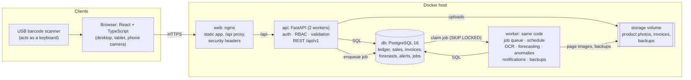
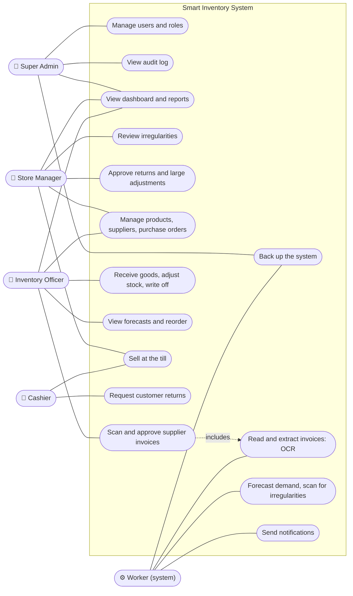
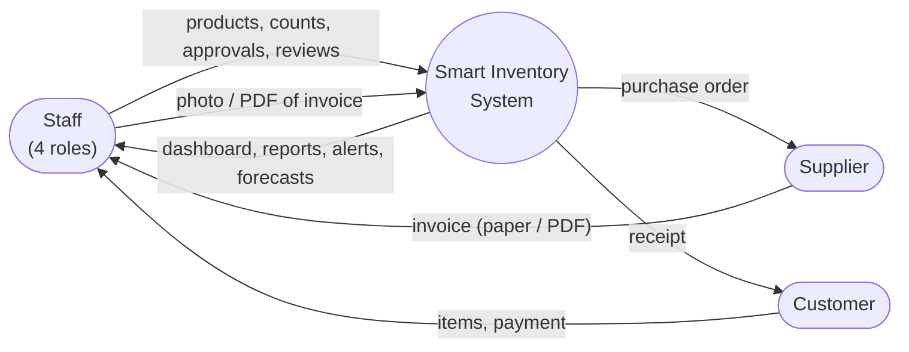
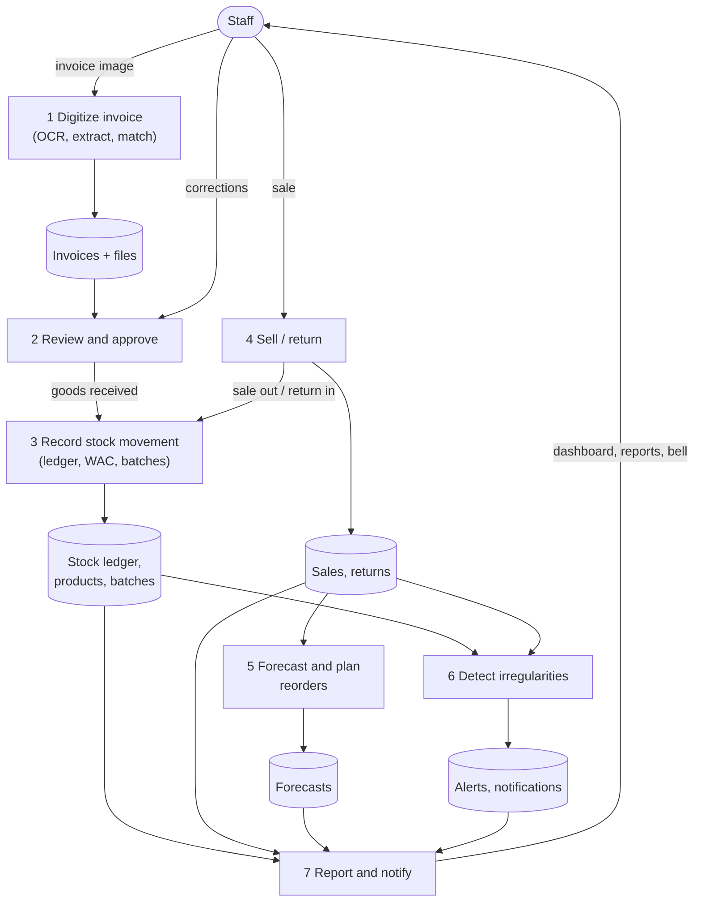
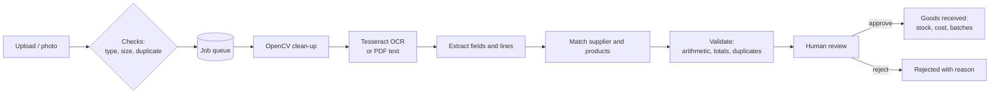

# System architecture

This describes the system **as built**. The original design and its reasoning are in
[00-system-design-plan.md](00-system-design-plan.md). Diagrams use Mermaid, which GitHub,
GitLab and most Markdown editors render.

## 1. Architecture diagram

The design is a modular monolith: one FastAPI code base, run as two processes (the API and a
background worker), behind nginx. It uses PostgreSQL 16 and a file-storage volume. Everything
runs with `docker compose up` on one laptop or a small server.

| Part | Technology | What it does |
|---|---|---|
| Frontend | React 18, TypeScript, Tailwind, TanStack Query, Recharts, lucide | Role-aware screens; the access token is kept in memory only |
| API | FastAPI, SQLAlchemy 2, Pydantic 2 | Validation, permissions on every endpoint, business rules in a service layer |
| Worker | Same code base, `python -m app.workers.runner` | Postgres-backed job queue (`background_jobs`, `FOR UPDATE SKIP LOCKED`), retries, periodic jobs |
| AI | OpenCV, Tesseract 5, pdfplumber, RapidFuzz; pandas, statsmodels, scikit-learn | OCR pipeline; forecasting models; Isolation Forest. All CPU-only |
| Database | PostgreSQL 16, Alembic migrations | Append-only stock ledger enforced by a trigger, check constraints, sequences |
| Files | Docker volume `storage` | Served only to signed-in users with the right permission (no public URLs) |

**Code layout (backend).**
- `app/api/v1/` holds HTTP routes only.
- `app/services/` holds the business rules. All stock changes go through one function, `inventory_service.apply_movement`.
- `app/ai/` holds pure engines (OCR, forecasting, anomaly detection) that have no database access, so they can be unit-tested and evaluated on their own.
- `app/workers/` has the job handlers and the schedule.
- `app/reports/` has the PDF, Excel and CSV writers.

## 2. Use-case diagram

The Super Admin can also do everything a Store Manager can. The full permission matrix is in
[00-system-design-plan.md](00-system-design-plan.md) section 2 and in
`backend/app/core/permissions.py`.

## 3. Data flow diagrams

### Level 0 (context)

### Level 1

## 4. Key flows

**Stock.** Every change is a row in `stock_movements`. The table is append-only (a database
trigger refuses updates and deletes). Each change goes through `apply_movement`, which:
- locks the product row
- recalculates the weighted average cost on receipt
- takes stock from the oldest-expiring batch first on sale
- refuses negative stock unless an administrator explicitly allows it
- raises a low-stock notification when the line is crossed

**Sales.** Prices include VAT, and VAT is extracted per line. Each line stores its cost at the
moment of sale, so profit is exact even when supplier prices change later. Checkout is
idempotent (a one-time request id), and two tills cannot oversell the last item.

**Invoice digitization.** See [ai/ocr-methodology.md](ai/ocr-methodology.md) for the full
workflow diagram:

**Forecasting and irregularities.**
- Every night the worker backtests six forecasting models per product and keeps the best one. It then stores 28-day forecasts and reorder advice, and sends shortage notifications.
- Every three hours it compares each product's and each person's day with their own normal, using rules and an Isolation Forest.
- See [ai/forecasting-and-anomalies.md](ai/forecasting-and-anomalies.md).

## 5. Security

| Area | Measure |
|---|---|
| Passwords | Argon2id hashes; strength rules; forced change of temporary passwords |
| Sessions | 15-minute access token kept in memory; rotating refresh token in an HttpOnly, SameSite=Strict cookie limited to `/api/v1/auth`; reuse of an old refresh token revokes the session |
| CSRF | Custom `X-Requested-With` header required; strict cookies |
| Access control | Permission check on every endpoint (server side), not only hidden buttons; staff-related irregularities limited to reviewers; nobody approves their own return or reviews an alert about themselves |
| Input | Pydantic validation; SQLAlchemy parameters (no string-built SQL from user input); uploads checked by content (magic bytes), size and page count, stored outside the web root with random names |
| Abuse | Rate limits on sign-in, password reset and report generation |
| Transport and browser | nginx security headers: CSP, X-Frame-Options DENY, nosniff, Referrer-Policy; TLS in deployment (see installation guide) |
| Secrets | From environment variables (`.env`, never committed); the frontend contains no secrets or database credentials |
| Audit | Sign-ins, user changes, stock adjustments, approvals, price changes, report exports and backups are written to `audit_logs` |
| Recovery | Nightly verified backups with rotation; tested restore procedure |
