# Database schema

Generated from the SQLAlchemy models by `python -m scripts.generate_docs`; the Alembic migrations in `backend/alembic/versions` create exactly these tables. PostgreSQL 16.

34 tables. Money is `numeric(14,2)` (KES), costs `numeric(14,4)`, quantities `numeric(14,3)`; timestamps are stored with time zone (UTC) and shown in store time.

## Entity relationship diagram

Primary and foreign keys only; full columns are listed below.

```mermaid
erDiagram
    permissions ||--o{ role_permissions : "permission_id"
    roles ||--o{ role_permissions : "role_id"
    roles ||--o{ users : "role_id"
    users ||--o{ user_sessions : "user_id"
    users ||--o{ password_reset_tokens : "user_id"
    users |o--o{ password_reset_tokens : "created_by_id"
    categories |o--o{ categories : "parent_id"
    suppliers |o--o{ products : "default_supplier_id"
    categories |o--o{ products : "category_id"
    products ||--o{ product_batches : "product_id"
    users |o--o{ forecast_runs : "triggered_by_id"
    forecast_runs ||--o{ forecast_products : "run_id"
    products ||--o{ forecast_products : "product_id"
    products ||--o{ forecasts : "product_id"
    forecast_runs ||--o{ forecasts : "run_id"
    users |o--o{ anomaly_alerts : "reviewed_by_id"
    users |o--o{ anomaly_alerts : "subject_user_id"
    products |o--o{ anomaly_alerts : "product_id"
    users ||--o{ notifications : "user_id"
    users ||--o{ sales : "cashier_id"
    customers |o--o{ sales : "customer_id"
    sales ||--o{ sale_items : "sale_id"
    products ||--o{ sale_items : "product_id"
    users ||--o{ sale_returns : "requested_by_id"
    sales ||--o{ sale_returns : "sale_id"
    users |o--o{ sale_returns : "decided_by_id"
    sale_returns ||--o{ sale_return_items : "return_id"
    sale_items ||--o{ sale_return_items : "sale_item_id"
    users ||--o{ expenses : "recorded_by_id"
    expense_categories ||--o{ expenses : "category_id"
    suppliers ||--o{ supplier_products : "supplier_id"
    products ||--o{ supplier_products : "product_id"
    users |o--o{ invoices : "reviewed_by_id"
    users ||--o{ invoices : "uploaded_by_id"
    purchases |o--o{ invoices : "purchase_id"
    suppliers |o--o{ invoices : "supplier_id"
    products |o--o{ invoice_items : "product_id"
    invoices ||--o{ invoice_items : "invoice_id"
    suppliers ||--o{ supplier_product_aliases : "supplier_id"
    products ||--o{ supplier_product_aliases : "product_id"
    suppliers ||--o{ purchase_orders : "supplier_id"
    users ||--o{ purchase_orders : "created_by_id"
    products ||--o{ purchase_order_items : "product_id"
    purchase_orders ||--o{ purchase_order_items : "purchase_order_id"
    users ||--o{ purchases : "received_by_id"
    suppliers ||--o{ purchases : "supplier_id"
    purchase_orders |o--o{ purchases : "purchase_order_id"
    products ||--o{ purchase_items : "product_id"
    purchases ||--o{ purchase_items : "purchase_id"
    purchase_order_items |o--o{ purchase_items : "purchase_order_item_id"
    product_batches |o--o{ stock_movements : "batch_id"
    products ||--o{ stock_movements : "product_id"
    users ||--o{ stock_movements : "user_id"
    users |o--o{ stock_adjustments : "decided_by_id"
    users ||--o{ stock_adjustments : "requested_by_id"
    product_batches |o--o{ stock_adjustments : "batch_id"
    products ||--o{ stock_adjustments : "product_id"
    users |o--o{ audit_logs : "user_id"
```

## Identity and audit

### `users`

| Column | Type | Null | Key / default |
|---|---|---|---|
| `full_name` | varchar(150) | no |  |
| `username` | varchar(50) | no | unique |
| `email` | varchar(255) | no | unique |
| `phone` | varchar(30) | yes |  |
| `password_hash` | varchar(255) | no |  |
| `role_id` | BIGINT | no | FK → `roles.id` |
| `is_active` | BOOLEAN | no |  |
| `must_change_password` | BOOLEAN | no |  |
| `failed_login_count` | INTEGER | no |  |
| `locked_until` | DATETIME | yes |  |
| `last_login_at` | DATETIME | yes |  |
| `password_changed_at` | DATETIME | yes |  |
| `created_by_id` | BIGINT | yes | FK → `users.id` |
| `id` | BIGINT | no | PK |
| `created_at` | DATETIME | no | default now() |
| `updated_at` | DATETIME | no | default now() |

Constraints and indexes: check `ck_users_failed_login_count_non_negative`: `failed_login_count >= 0`; check `ck_users_email_lowercase`: `email = lower(email)`; check `ck_users_username_lowercase`: `username = lower(username)`; index `ix_users_role_id` (role_id).

### `roles`

| Column | Type | Null | Key / default |
|---|---|---|---|
| `name` | varchar(50) | no | unique |
| `display_name` | varchar(100) | no |  |
| `description` | varchar(255) | no |  |
| `id` | BIGINT | no | PK |
| `created_at` | DATETIME | no | default now() |
| `updated_at` | DATETIME | no | default now() |

### `permissions`

| Column | Type | Null | Key / default |
|---|---|---|---|
| `code` | varchar(64) | no | unique |
| `description` | varchar(255) | no |  |
| `id` | BIGINT | no | PK |

### `role_permissions`

| Column | Type | Null | Key / default |
|---|---|---|---|
| `role_id` | BIGINT | no | PK, FK → `roles.id` |
| `permission_id` | BIGINT | no | PK, FK → `permissions.id` |

### `user_sessions`

| Column | Type | Null | Key / default |
|---|---|---|---|
| `user_id` | BIGINT | no | FK → `users.id` |
| `refresh_token_hash` | varchar(64) | no | unique |
| `previous_token_hash` | varchar(64) | yes |  |
| `rotated_at` | DATETIME | yes |  |
| `user_agent` | varchar(255) | yes |  |
| `ip_address` | varchar(45) | yes |  |
| `created_at` | DATETIME | no |  |
| `last_used_at` | DATETIME | no |  |
| `expires_at` | DATETIME | no |  |
| `revoked_at` | DATETIME | yes |  |
| `revoked_reason` | varchar(50) | yes |  |
| `id` | BIGINT | no | PK |

Constraints and indexes: index `ix_user_sessions_user_id` (user_id); index `ix_user_sessions_previous_token_hash` (previous_token_hash).

### `password_reset_tokens`

| Column | Type | Null | Key / default |
|---|---|---|---|
| `user_id` | BIGINT | no | FK → `users.id` |
| `token_hash` | varchar(64) | no | unique |
| `created_by_id` | BIGINT | yes | FK → `users.id` |
| `created_at` | DATETIME | no |  |
| `expires_at` | DATETIME | no |  |
| `used_at` | DATETIME | yes |  |
| `note` | TEXT | yes |  |
| `id` | BIGINT | no | PK |

Constraints and indexes: index `ix_password_reset_tokens_user_id` (user_id).

### `audit_logs`

| Column | Type | Null | Key / default |
|---|---|---|---|
| `user_id` | BIGINT | yes | FK → `users.id` |
| `action` | varchar(64) | no |  |
| `entity_type` | varchar(64) | yes |  |
| `entity_id` | varchar(64) | yes |  |
| `before` | JSONB | yes |  |
| `after` | JSONB | yes |  |
| `details` | TEXT | yes |  |
| `ip_address` | varchar(45) | yes |  |
| `user_agent` | varchar(255) | yes |  |
| `created_at` | DATETIME | no | default now() |
| `id` | BIGINT | no | PK |

Constraints and indexes: index `ix_audit_logs_action` (action); index `ix_audit_logs_user_created` (user_id, created_at); index `ix_audit_logs_entity` (entity_type, entity_id); index `ix_audit_logs_created_at` (created_at).

### `background_jobs`

| Column | Type | Null | Key / default |
|---|---|---|---|
| `job_type` | varchar(64) | no |  |
| `payload` | JSONB | no |  |
| `status` | varchar(16) | no |  |
| `attempts` | INTEGER | no |  |
| `max_attempts` | INTEGER | no |  |
| `run_after` | DATETIME | no | default now() |
| `locked_at` | DATETIME | yes |  |
| `finished_at` | DATETIME | yes |  |
| `result` | JSONB | yes |  |
| `error` | TEXT | yes |  |
| `created_at` | DATETIME | no | default now() |
| `id` | BIGINT | no | PK |

Constraints and indexes: check `ck_background_jobs_status_valid`: `status IN ('PENDING', 'RUNNING', 'SUCCEEDED', 'FAILED')`; check `ck_background_jobs_attempts_non_negative`: `attempts >= 0`; index `ix_background_jobs_status_run_after` (status, run_after).

## Catalogue and suppliers

### `categories`

| Column | Type | Null | Key / default |
|---|---|---|---|
| `name` | varchar(100) | no |  |
| `description` | TEXT | yes |  |
| `parent_id` | BIGINT | yes | FK → `categories.id` |
| `is_active` | BOOLEAN | no |  |
| `id` | BIGINT | no | PK |
| `created_at` | DATETIME | no | default now() |
| `updated_at` | DATETIME | no | default now() |

Constraints and indexes: check `ck_categories_not_own_parent`: `parent_id IS NULL OR parent_id <> id`; index `ix_categories_parent_id` (parent_id); unique index `uq_categories_parent_name` (coalesce(parent_id, 0), lower(name)).

### `products`

| Column | Type | Null | Key / default |
|---|---|---|---|
| `sku` | varchar(40) | no |  |
| `barcode` | varchar(32) | yes |  |
| `name` | varchar(150) | no |  |
| `description` | TEXT | yes |  |
| `category_id` | BIGINT | yes | FK → `categories.id` |
| `default_supplier_id` | BIGINT | yes | FK → `suppliers.id` |
| `unit_of_measure` | varchar(10) | no |  |
| `image_path` | varchar(255) | yes |  |
| `selling_price` | numeric(14, 2) | no |  |
| `purchase_price` | numeric(14, 2) | no |  |
| `avg_cost` | numeric(14, 4) | no |  |
| `vat_rate` | numeric(5, 2) | no |  |
| `quantity_on_hand` | numeric(12, 3) | no |  |
| `min_stock_level` | numeric(12, 3) | no |  |
| `max_stock_level` | numeric(12, 3) | yes |  |
| `reorder_lead_time_days` | INTEGER | no |  |
| `tracks_expiry` | BOOLEAN | no |  |
| `is_active` | BOOLEAN | no |  |
| `id` | BIGINT | no | PK |
| `created_at` | DATETIME | no | default now() |
| `updated_at` | DATETIME | no | default now() |

Constraints and indexes: check `ck_products_unit_valid`: `unit_of_measure IN ('pcs', 'pack', 'box', 'dozen', 'bottle', 'carton', 'bag', 'kg', 'g', 'l', 'ml')`; check `ck_products_purchase_price_non_negative`: `purchase_price >= 0`; check `ck_products_max_not_below_min`: `max_stock_level IS NULL OR max_stock_level >= min_stock_level`; check `ck_products_selling_price_non_negative`: `selling_price >= 0`; check `ck_products_vat_rate_range`: `vat_rate >= 0 AND vat_rate <= 100`; check `ck_products_lead_time_non_negative`: `reorder_lead_time_days >= 0`; check `ck_products_avg_cost_non_negative`: `avg_cost >= 0`; check `ck_products_min_stock_non_negative`: `min_stock_level >= 0`; unique index `uq_products_barcode` (barcode) where `barcode IS NOT NULL`; unique index `uq_products_sku` (upper(sku)); index `ix_products_category_id` (category_id); index `ix_products_default_supplier_id` (default_supplier_id); index `ix_products_name_trgm` (name).

### `product_batches`

| Column | Type | Null | Key / default |
|---|---|---|---|
| `product_id` | BIGINT | no | FK → `products.id` |
| `batch_number` | varchar(50) | yes |  |
| `expiry_date` | DATE | yes |  |
| `quantity_received` | numeric(12, 3) | no |  |
| `quantity_remaining` | numeric(12, 3) | no |  |
| `unit_cost` | numeric(14, 4) | no |  |
| `received_at` | DATETIME | no | default now() |
| `id` | BIGINT | no | PK |

Constraints and indexes: check `ck_product_batches_remaining_le_received`: `quantity_remaining <= quantity_received`; check `ck_product_batches_received_positive`: `quantity_received > 0`; check `ck_product_batches_remaining_non_negative`: `quantity_remaining >= 0`; index `ix_product_batches_product_expiry` (product_id, expiry_date).

### `suppliers`

| Column | Type | Null | Key / default |
|---|---|---|---|
| `name` | varchar(150) | no |  |
| `kra_pin` | varchar(11) | yes |  |
| `contact_person` | varchar(150) | yes |  |
| `phone` | varchar(30) | yes |  |
| `email` | varchar(255) | yes |  |
| `address` | TEXT | yes |  |
| `payment_terms_days` | INTEGER | no |  |
| `notes` | TEXT | yes |  |
| `is_active` | BOOLEAN | no |  |
| `id` | BIGINT | no | PK |
| `created_at` | DATETIME | no | default now() |
| `updated_at` | DATETIME | no | default now() |

Constraints and indexes: check `ck_suppliers_terms_non_negative`: `payment_terms_days >= 0`; unique index `uq_suppliers_kra_pin` (kra_pin) where `kra_pin IS NOT NULL`; unique index `uq_suppliers_name` (lower(name)).

### `supplier_products`

| Column | Type | Null | Key / default |
|---|---|---|---|
| `supplier_id` | BIGINT | no | PK, FK → `suppliers.id` |
| `product_id` | BIGINT | no | PK, FK → `products.id` |
| `supplier_sku` | varchar(50) | yes |  |
| `last_unit_price` | numeric(14, 2) | yes |  |
| `lead_time_days` | INTEGER | yes |  |
| `created_at` | DATETIME | no | default now() |
| `updated_at` | DATETIME | no | default now() |

Constraints and indexes: check `ck_supplier_products_price_ok`: `last_unit_price IS NULL OR last_unit_price >= 0`; check `ck_supplier_products_lead_time_ok`: `lead_time_days IS NULL OR lead_time_days >= 0`.

## Stock

### `stock_movements`

| Column | Type | Null | Key / default |
|---|---|---|---|
| `product_id` | BIGINT | no | FK → `products.id` |
| `batch_id` | BIGINT | yes | FK → `product_batches.id` |
| `movement_type` | varchar(24) | no |  |
| `quantity` | numeric(12, 3) | no |  |
| `unit_cost` | numeric(14, 4) | no |  |
| `balance_after` | numeric(12, 3) | no |  |
| `reference_type` | varchar(32) | yes |  |
| `reference_id` | varchar(64) | yes |  |
| `reason` | TEXT | yes |  |
| `user_id` | BIGINT | no | FK → `users.id` |
| `created_at` | DATETIME | no | default now() |
| `id` | BIGINT | no | PK |

Constraints and indexes: check `ck_stock_movements_type_valid`: `movement_type IN ('OPENING', 'PURCHASE_IN', 'RETURN_IN', 'ADJUSTMENT_IN', 'SALE_OUT', 'RETURN_TO_SUPPLIER', 'DAMAGED', 'EXPIRED', 'ADJUSTMENT_OUT')`; check `ck_stock_movements_sign_matches_type`: `(movement_type IN ('OPENING', 'PURCHASE_IN', 'RETURN_IN', 'ADJUSTMENT_IN') AND quantity > 0) OR (movement_type IN ('SALE_OUT', 'RETURN_TO_SUPPLIER', 'DAMAGED', 'EXPIRED', 'ADJUSTMENT_OUT') AND quantity < 0)`; check `ck_stock_movements_quantity_non_zero`: `quantity <> 0`; index `ix_stock_movements_reference` (reference_type, reference_id); index `ix_stock_movements_type_created` (movement_type, created_at); index `ix_stock_movements_user_created` (user_id, created_at); index `ix_stock_movements_product_created` (product_id, created_at).

### `stock_adjustments`

| Column | Type | Null | Key / default |
|---|---|---|---|
| `product_id` | BIGINT | no | FK → `products.id` |
| `batch_id` | BIGINT | yes | FK → `product_batches.id` |
| `reason_code` | varchar(24) | no |  |
| `notes` | TEXT | yes |  |
| `system_quantity` | numeric(12, 3) | no |  |
| `counted_quantity` | numeric(12, 3) | yes |  |
| `quantity_change` | numeric(12, 3) | no |  |
| `expiry_date` | DATE | yes |  |
| `unit_cost` | numeric(14, 4) | no |  |
| `value_impact` | numeric(14, 2) | no |  |
| `allow_negative` | BOOLEAN | no |  |
| `status` | varchar(12) | no |  |
| `requested_by_id` | BIGINT | no | FK → `users.id` |
| `decided_by_id` | BIGINT | yes | FK → `users.id` |
| `decided_at` | DATETIME | yes |  |
| `decision_note` | TEXT | yes |  |
| `created_at` | DATETIME | no | default now() |
| `id` | BIGINT | no | PK |

Constraints and indexes: check `ck_stock_adjustments_reason_valid`: `reason_code IN ('COUNT_CORRECTION', 'FOUND_STOCK', 'DATA_ENTRY_ERROR', 'THEFT_SUSPECTED', 'INTERNAL_USE', 'OTHER')`; check `ck_stock_adjustments_change_non_zero`: `quantity_change <> 0`; check `ck_stock_adjustments_status_valid`: `status IN ('PENDING', 'APPROVED', 'REJECTED')`; index `ix_stock_adjustments_status_created` (status, created_at); index `ix_stock_adjustments_product` (product_id).

## Sales

### `customers`

| Column | Type | Null | Key / default |
|---|---|---|---|
| `name` | varchar(150) | no |  |
| `phone` | varchar(30) | yes |  |
| `email` | varchar(255) | yes |  |
| `notes` | TEXT | yes |  |
| `id` | BIGINT | no | PK |
| `created_at` | DATETIME | no | default now() |
| `updated_at` | DATETIME | no | default now() |

Constraints and indexes: unique index `uq_customers_phone` (phone) where `phone IS NOT NULL`.

### `sales`

| Column | Type | Null | Key / default |
|---|---|---|---|
| `receipt_number` | varchar(32) | no | unique |
| `client_request_id` | UUID | yes | unique |
| `cashier_id` | BIGINT | no | FK → `users.id` |
| `customer_id` | BIGINT | yes | FK → `customers.id` |
| `sold_at` | DATETIME | no | default now() |
| `status` | varchar(20) | no |  |
| `subtotal` | numeric(14, 2) | no |  |
| `discount_total` | numeric(14, 2) | no |  |
| `tax_total` | numeric(14, 2) | no |  |
| `grand_total` | numeric(14, 2) | no |  |
| `cost_total` | numeric(14, 2) | no |  |
| `payment_method` | varchar(10) | no |  |
| `payment_reference` | varchar(40) | yes |  |
| `amount_tendered` | numeric(14, 2) | yes |  |
| `change_given` | numeric(14, 2) | yes |  |
| `notes` | TEXT | yes |  |
| `id` | BIGINT | no | PK |

Constraints and indexes: check `ck_sales_discount_ok`: `discount_total >= 0 AND discount_total <= subtotal`; check `ck_sales_payment_method_valid`: `payment_method IN ('CASH', 'MPESA', 'CARD')`; check `ck_sales_totals_non_negative`: `grand_total >= 0 AND subtotal >= 0`; check `ck_sales_status_valid`: `status IN ('COMPLETED', 'PARTIALLY_RETURNED', 'RETURNED')`; check `ck_sales_tendered_covers`: `amount_tendered IS NULL OR amount_tendered >= grand_total`; index `ix_sales_sold_at` (sold_at); index `ix_sales_cashier_sold_at` (cashier_id, sold_at).

### `sale_items`

| Column | Type | Null | Key / default |
|---|---|---|---|
| `sale_id` | BIGINT | no | FK → `sales.id` |
| `product_id` | BIGINT | no | FK → `products.id` |
| `product_name` | varchar(150) | no |  |
| `quantity` | numeric(12, 3) | no |  |
| `unit_price` | numeric(14, 2) | no |  |
| `discount_amount` | numeric(14, 2) | no |  |
| `vat_rate` | numeric(14, 2) | no |  |
| `tax_amount` | numeric(14, 2) | no |  |
| `line_total` | numeric(14, 2) | no |  |
| `unit_cost` | numeric(14, 4) | no |  |
| `returned_quantity` | numeric(12, 3) | no |  |
| `id` | BIGINT | no | PK |

Constraints and indexes: check `ck_sale_items_returned_ok`: `returned_quantity >= 0 AND returned_quantity <= quantity`; check `ck_sale_items_quantity_positive`: `quantity > 0`; check `ck_sale_items_line_total_non_negative`: `line_total >= 0`; check `ck_sale_items_discount_non_negative`: `discount_amount >= 0`; index `ix_sale_items_product` (product_id); index `ix_sale_items_sale_id` (sale_id).

### `sale_returns`

| Column | Type | Null | Key / default |
|---|---|---|---|
| `return_number` | varchar(32) | no | unique |
| `sale_id` | BIGINT | no | FK → `sales.id` |
| `status` | varchar(12) | no |  |
| `reason` | TEXT | no |  |
| `refund_method` | varchar(10) | no |  |
| `refund_total` | numeric(14, 2) | no |  |
| `requested_by_id` | BIGINT | no | FK → `users.id` |
| `decided_by_id` | BIGINT | yes | FK → `users.id` |
| `decided_at` | DATETIME | yes |  |
| `decision_note` | TEXT | yes |  |
| `created_at` | DATETIME | no | default now() |
| `id` | BIGINT | no | PK |

Constraints and indexes: check `ck_sale_returns_refund_method_valid`: `refund_method IN ('CASH', 'MPESA', 'CARD')`; check `ck_sale_returns_status_valid`: `status IN ('PENDING', 'APPROVED', 'REJECTED')`; check `ck_sale_returns_refund_positive`: `refund_total > 0`; index `ix_sale_returns_sale_id` (sale_id); index `ix_sale_returns_status_created` (status, created_at).

### `sale_return_items`

| Column | Type | Null | Key / default |
|---|---|---|---|
| `return_id` | BIGINT | no | FK → `sale_returns.id` |
| `sale_item_id` | BIGINT | no | FK → `sale_items.id` |
| `quantity` | numeric(12, 3) | no |  |
| `refund_amount` | numeric(14, 2) | no |  |
| `condition` | varchar(12) | no |  |
| `id` | BIGINT | no | PK |

Constraints and indexes: check `ck_sale_return_items_quantity_positive`: `quantity > 0`; check `ck_sale_return_items_condition_valid`: `condition IN ('RESALEABLE', 'DAMAGED')`; index `ix_sale_return_items_return_id` (return_id); index `ix_sale_return_items_sale_item_id` (sale_item_id).

## Purchasing and finance

### `purchase_orders`

| Column | Type | Null | Key / default |
|---|---|---|---|
| `po_number` | varchar(32) | no | unique |
| `supplier_id` | BIGINT | no | FK → `suppliers.id` |
| `status` | varchar(12) | no |  |
| `order_date` | DATE | no |  |
| `expected_date` | DATE | yes |  |
| `notes` | TEXT | yes |  |
| `created_by_id` | BIGINT | no | FK → `users.id` |
| `sent_at` | DATETIME | yes |  |
| `id` | BIGINT | no | PK |
| `created_at` | DATETIME | no | default now() |
| `updated_at` | DATETIME | no | default now() |

Constraints and indexes: check `ck_purchase_orders_status_valid`: `status IN ('DRAFT', 'SENT', 'PARTIAL', 'RECEIVED', 'CANCELLED')`; index `ix_purchase_orders_status` (status); index `ix_purchase_orders_supplier_id` (supplier_id).

### `purchase_order_items`

| Column | Type | Null | Key / default |
|---|---|---|---|
| `purchase_order_id` | BIGINT | no | FK → `purchase_orders.id` |
| `product_id` | BIGINT | no | FK → `products.id` |
| `quantity_ordered` | numeric(12, 3) | no |  |
| `quantity_received` | numeric(12, 3) | no |  |
| `unit_cost` | numeric(14, 2) | no |  |
| `id` | BIGINT | no | PK |

Constraints and indexes: unique (purchase_order_id, product_id); check `ck_purchase_order_items_ordered_positive`: `quantity_ordered > 0`; check `ck_purchase_order_items_cost_non_negative`: `unit_cost >= 0`; check `ck_purchase_order_items_received_non_negative`: `quantity_received >= 0`; index `ix_purchase_order_items_purchase_order_id` (purchase_order_id).

### `purchases`

| Column | Type | Null | Key / default |
|---|---|---|---|
| `grn_number` | varchar(32) | no | unique |
| `supplier_id` | BIGINT | no | FK → `suppliers.id` |
| `purchase_order_id` | BIGINT | yes | FK → `purchase_orders.id` |
| `supplier_invoice_number` | varchar(50) | yes |  |
| `invoice_date` | DATE | yes |  |
| `received_at` | DATETIME | no | default now() |
| `subtotal` | numeric(14, 2) | no |  |
| `tax_total` | numeric(14, 2) | no |  |
| `grand_total` | numeric(14, 2) | no |  |
| `source` | varchar(10) | no |  |
| `notes` | TEXT | yes |  |
| `received_by_id` | BIGINT | no | FK → `users.id` |
| `id` | BIGINT | no | PK |

Constraints and indexes: check `ck_purchases_source_valid`: `source IN ('MANUAL', 'INVOICE')`; check `ck_purchases_total_non_negative`: `grand_total >= 0`; index `ix_purchases_supplier_id` (supplier_id); unique index `uq_purchases_supplier_invoice` (supplier_id, upper(supplier_invoice_number)) where `supplier_invoice_number IS NOT NULL`; index `ix_purchases_received_at` (received_at); index `ix_purchases_purchase_order_id` (purchase_order_id).

### `purchase_items`

| Column | Type | Null | Key / default |
|---|---|---|---|
| `purchase_id` | BIGINT | no | FK → `purchases.id` |
| `product_id` | BIGINT | no | FK → `products.id` |
| `purchase_order_item_id` | BIGINT | yes | FK → `purchase_order_items.id` |
| `quantity` | numeric(12, 3) | no |  |
| `unit_cost` | numeric(14, 4) | no |  |
| `vat_rate` | numeric(14, 2) | no |  |
| `tax_amount` | numeric(14, 2) | no |  |
| `line_total` | numeric(14, 2) | no |  |
| `previous_unit_cost` | numeric(14, 4) | yes |  |
| `batch_number` | varchar(50) | yes |  |
| `expiry_date` | DATE | yes |  |
| `id` | BIGINT | no | PK |

Constraints and indexes: check `ck_purchase_items_cost_non_negative`: `unit_cost >= 0`; check `ck_purchase_items_quantity_positive`: `quantity > 0`; index `ix_purchase_items_purchase_id` (purchase_id); index `ix_purchase_items_product` (product_id).

### `expense_categories`

| Column | Type | Null | Key / default |
|---|---|---|---|
| `name` | varchar(80) | no |  |
| `is_active` | BOOLEAN | no |  |
| `id` | BIGINT | no | PK |

Constraints and indexes: unique index `uq_expense_categories_name` (lower(name)).

### `expenses`

| Column | Type | Null | Key / default |
|---|---|---|---|
| `category_id` | BIGINT | no | FK → `expense_categories.id` |
| `expense_date` | DATE | no |  |
| `amount` | numeric(14, 2) | no |  |
| `description` | TEXT | no |  |
| `payment_method` | varchar(10) | no |  |
| `reference` | varchar(50) | yes |  |
| `recorded_by_id` | BIGINT | no | FK → `users.id` |
| `id` | BIGINT | no | PK |
| `created_at` | DATETIME | no | default now() |
| `updated_at` | DATETIME | no | default now() |

Constraints and indexes: check `ck_expenses_amount_positive`: `amount > 0`; check `ck_expenses_payment_method_valid`: `payment_method IN ('CASH', 'MPESA', 'CARD', 'BANK')`; index `ix_expenses_date` (expense_date); index `ix_expenses_category_id` (category_id).

## Invoice digitization

### `invoices`

| Column | Type | Null | Key / default |
|---|---|---|---|
| `file_path` | varchar(255) | no |  |
| `original_filename` | varchar(255) | no |  |
| `mime_type` | varchar(50) | no |  |
| `file_size` | INTEGER | no |  |
| `file_sha256` | varchar(64) | no | unique |
| `page_count` | INTEGER | no |  |
| `uploaded_by_id` | BIGINT | no | FK → `users.id` |
| `status` | varchar(16) | no |  |
| `ocr_engine` | varchar(20) | yes |  |
| `ocr_text` | TEXT | yes |  |
| `quality` | JSONB | yes |  |
| `processing_steps` | JSONB | yes |  |
| `processing_ms` | INTEGER | yes |  |
| `error_message` | TEXT | yes |  |
| `supplier_id` | BIGINT | yes | FK → `suppliers.id` |
| `supplier_match_score` | FLOAT | yes |  |
| `extracted_supplier_name` | varchar(255) | yes |  |
| `kra_pin` | varchar(11) | yes |  |
| `invoice_number` | varchar(50) | yes |  |
| `invoice_date` | DATE | yes |  |
| `subtotal` | numeric(14, 2) | yes |  |
| `tax_total` | numeric(14, 2) | yes |  |
| `grand_total` | numeric(14, 2) | yes |  |
| `prices_include_vat` | BOOLEAN | no |  |
| `field_confidences` | JSONB | yes |  |
| `original_fields` | JSONB | yes |  |
| `flags` | JSONB | yes |  |
| `reviewed_by_id` | BIGINT | yes | FK → `users.id` |
| `reviewed_at` | DATETIME | yes |  |
| `review_note` | TEXT | yes |  |
| `purchase_id` | BIGINT | yes | FK → `purchases.id`, unique |
| `id` | BIGINT | no | PK |
| `created_at` | DATETIME | no | default now() |
| `updated_at` | DATETIME | no | default now() |

Constraints and indexes: check `ck_invoices_status_valid`: `status IN ('QUEUED', 'PROCESSING', 'NEEDS_REVIEW', 'APPROVED', 'REJECTED', 'FAILED')`; unique index `uq_invoices_approved_number` (supplier_id, upper(invoice_number)) where `status = 'APPROVED'`; index `ix_invoices_status_created` (status, created_at).

### `invoice_items`

| Column | Type | Null | Key / default |
|---|---|---|---|
| `invoice_id` | BIGINT | no | FK → `invoices.id` |
| `line_no` | INTEGER | no |  |
| `raw_text` | TEXT | yes |  |
| `description` | varchar(255) | no |  |
| `item_code` | varchar(50) | yes |  |
| `quantity` | numeric(12, 3) | yes |  |
| `unit_price` | numeric(14, 4) | yes |  |
| `line_total` | numeric(14, 2) | yes |  |
| `product_id` | BIGINT | yes | FK → `products.id` |
| `match_method` | varchar(8) | no |  |
| `match_score` | FLOAT | yes |  |
| `suggested` | BOOLEAN | no |  |
| `confidence` | FLOAT | no |  |
| `arithmetic_ok` | BOOLEAN | no |  |
| `batch_number` | varchar(50) | yes |  |
| `expiry_date` | DATE | yes |  |
| `original` | JSONB | yes |  |
| `was_corrected` | BOOLEAN | no |  |
| `id` | BIGINT | no | PK |

Constraints and indexes: check `ck_invoice_items_match_method_valid`: `match_method IN ('CODE', 'ALIAS', 'FUZZY', 'MANUAL', 'NONE')`; index `ix_invoice_items_product_id` (product_id); index `ix_invoice_items_invoice_id` (invoice_id).

### `supplier_product_aliases`

| Column | Type | Null | Key / default |
|---|---|---|---|
| `supplier_id` | BIGINT | no | FK → `suppliers.id` |
| `product_id` | BIGINT | no | FK → `products.id` |
| `alias_text` | varchar(255) | no |  |
| `times_confirmed` | INTEGER | no |  |
| `last_seen_at` | DATETIME | no | default now() |
| `id` | BIGINT | no | PK |
| `created_at` | DATETIME | no | default now() |
| `updated_at` | DATETIME | no | default now() |

Constraints and indexes: unique (supplier_id, alias_text); index `ix_supplier_product_aliases_product_id` (product_id).

## Forecasting, anomalies and notifications

### `forecast_runs`

| Column | Type | Null | Key / default |
|---|---|---|---|
| `started_at` | DATETIME | no | default now() |
| `finished_at` | DATETIME | yes |  |
| `status` | varchar(10) | no |  |
| `history_start` | DATE | yes |  |
| `history_end` | DATE | yes |  |
| `horizon_days` | INTEGER | no |  |
| `params` | JSONB | yes |  |
| `summary` | JSONB | yes |  |
| `error_message` | TEXT | yes |  |
| `triggered_by_id` | BIGINT | yes | FK → `users.id` |
| `id` | BIGINT | no | PK |

Constraints and indexes: check `ck_forecast_runs_status_valid`: `status IN ('RUNNING', 'SUCCEEDED', 'FAILED')`.

### `forecast_products`

| Column | Type | Null | Key / default |
|---|---|---|---|
| `run_id` | BIGINT | no | FK → `forecast_runs.id` |
| `product_id` | BIGINT | no | FK → `products.id` |
| `model_name` | varchar(30) | no |  |
| `low_confidence` | BOOLEAN | no |  |
| `history_days` | INTEGER | no |  |
| `scores` | JSONB | yes |  |
| `residual_std` | FLOAT | no |  |
| `avg_daily_28` | FLOAT | no |  |
| `demand_pattern` | varchar(14) | yes |  |
| `adi` | FLOAT | yes |  |
| `cv2` | FLOAT | yes |  |
| `abc_class` | varchar(1) | yes |  |
| `revenue_90d` | numeric(14, 2) | yes |  |
| `weekday_profile` | JSONB | yes |  |
| `payday_effect` | FLOAT | yes |  |
| `on_hand` | numeric(14, 3) | no |  |
| `on_order` | numeric(14, 3) | no |  |
| `lead_time_days` | INTEGER | no |  |
| `stockout_date` | DATE | yes |  |
| `days_of_cover` | FLOAT | yes |  |
| `safety_stock` | FLOAT | no |  |
| `reorder_point` | FLOAT | no |  |
| `should_order` | BOOLEAN | no |  |
| `suggested_quantity` | numeric(14, 3) | no |  |
| `id` | BIGINT | no | PK |

Constraints and indexes: unique (run_id, product_id); index `ix_forecast_products_product_id` (product_id); index `ix_forecast_products_run_id` (run_id).

### `forecasts`

| Column | Type | Null | Key / default |
|---|---|---|---|
| `run_id` | BIGINT | no | FK → `forecast_runs.id` |
| `product_id` | BIGINT | no | FK → `products.id` |
| `forecast_date` | DATE | no |  |
| `predicted_qty` | FLOAT | no |  |
| `lower_bound` | FLOAT | no |  |
| `upper_bound` | FLOAT | no |  |
| `model_name` | varchar(30) | no |  |
| `id` | BIGINT | no | PK |

Constraints and indexes: unique (run_id, product_id, forecast_date).

### `anomaly_alerts`

| Column | Type | Null | Key / default |
|---|---|---|---|
| `entity_type` | varchar(10) | no |  |
| `product_id` | BIGINT | yes | FK → `products.id` |
| `subject_user_id` | BIGINT | yes | FK → `users.id` |
| `kind` | varchar(30) | no |  |
| `detected_at` | DATETIME | no | default now() |
| `period_start` | DATE | no |  |
| `period_end` | DATE | no |  |
| `quantity` | FLOAT | no |  |
| `value_kes` | numeric(14, 2) | no |  |
| `severity` | varchar(6) | no |  |
| `score` | FLOAT | no |  |
| `detector` | varchar(16) | no |  |
| `explanation` | TEXT | no |  |
| `recommended_action` | TEXT | no |  |
| `evidence` | JSONB | yes |  |
| `status` | varchar(24) | no |  |
| `reviewed_by_id` | BIGINT | yes | FK → `users.id` |
| `reviewed_at` | DATETIME | yes |  |
| `review_notes` | TEXT | yes |  |
| `dedupe_key` | varchar(120) | no | unique |
| `id` | BIGINT | no | PK |

Constraints and indexes: check `ck_anomaly_alerts_entity_valid`: `(entity_type = 'product' AND product_id IS NOT NULL) OR (entity_type = 'user' AND subject_user_id IS NOT NULL)`; check `ck_anomaly_alerts_severity_valid`: `severity IN ('LOW', 'MEDIUM', 'HIGH')`; check `ck_anomaly_alerts_detector_valid`: `detector IN ('RULE', 'ISOLATION_FOREST', 'BOTH')`; check `ck_anomaly_alerts_status_valid`: `status IN ('OPEN', 'INVESTIGATING', 'RESOLVED_ISSUE_FOUND', 'RESOLVED_NO_ISSUE')`; index `ix_anomaly_alerts_status_detected` (status, detected_at); index `ix_anomaly_alerts_subject_user_id` (subject_user_id); index `ix_anomaly_alerts_product_id` (product_id).

### `notifications`

| Column | Type | Null | Key / default |
|---|---|---|---|
| `user_id` | BIGINT | no | FK → `users.id` |
| `type` | varchar(30) | no |  |
| `title` | varchar(200) | no |  |
| `message` | TEXT | no |  |
| `link` | varchar(255) | yes |  |
| `severity` | varchar(10) | no |  |
| `is_read` | BOOLEAN | no |  |
| `read_at` | DATETIME | yes |  |
| `dedupe_key` | varchar(150) | no |  |
| `created_at` | DATETIME | no | default now() |
| `id` | BIGINT | no | PK |

Constraints and indexes: unique (user_id, dedupe_key); check `ck_notifications_severity_valid`: `severity IN ('info', 'warning', 'critical')`; index `ix_notifications_user_unread` (user_id, is_read, created_at).

## Rules enforced in the database

- `stock_movements` is append-only: a trigger rejects UPDATE and DELETE, so the ledger cannot be rewritten (corrections are new movements).
- Check constraints keep quantities, prices and statuses valid even if application code had a bug; partial unique indexes stop the same supplier invoice being received twice.
- Document numbers (receipts, returns, orders, deliveries) come from PostgreSQL sequences, so they stay unique when several tills work at once. A sequence can skip a number if a transaction is rolled back, so numbers are unique but not guaranteed consecutive.
